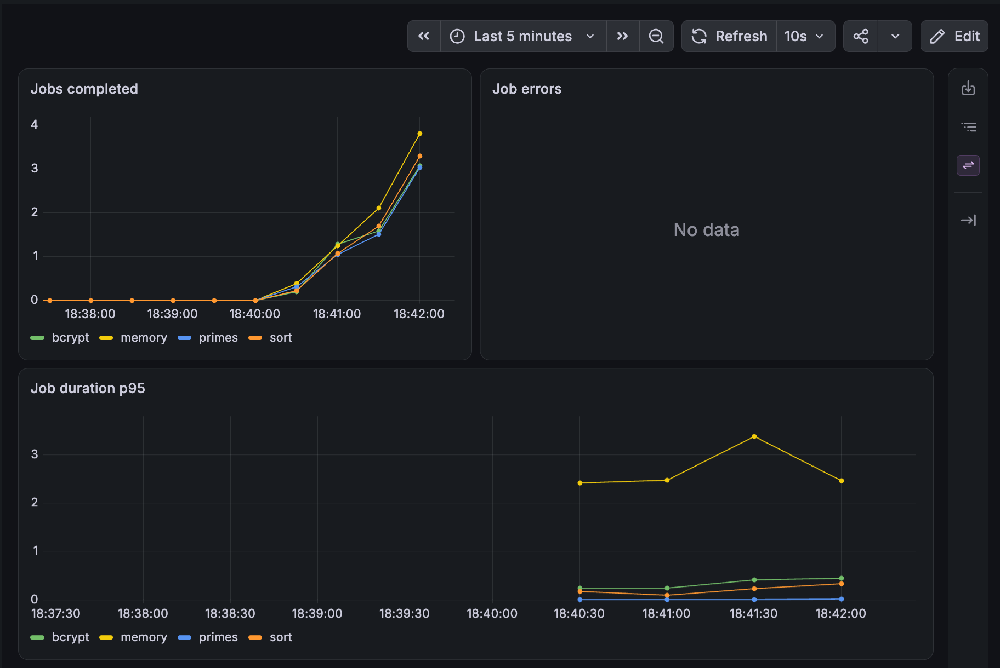
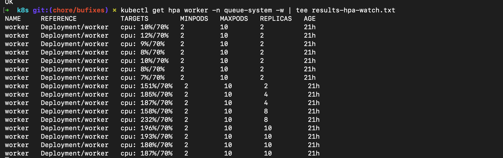
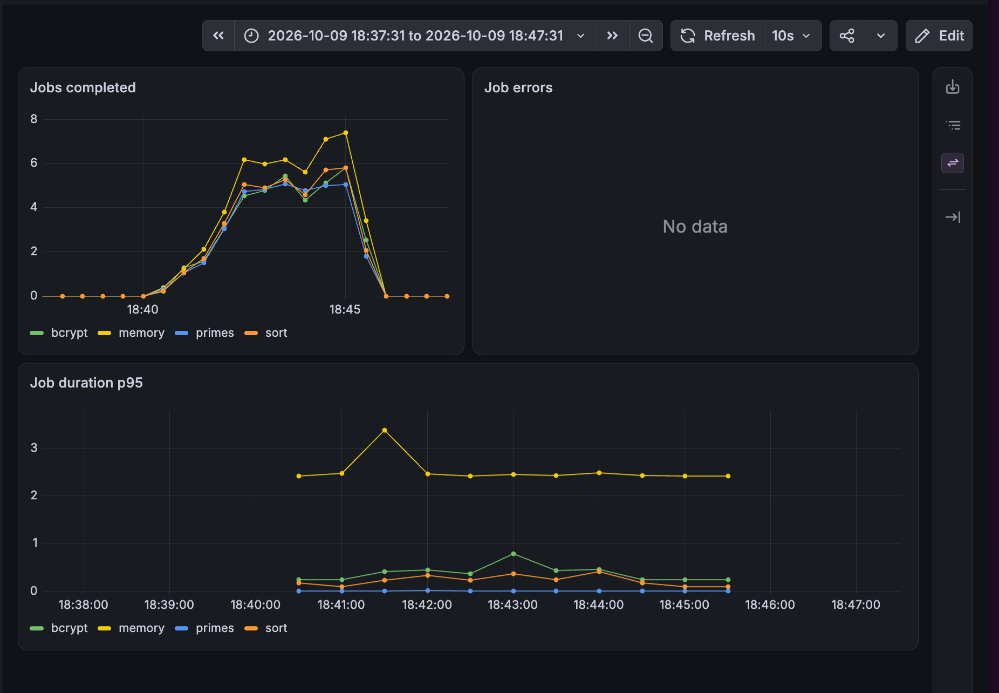
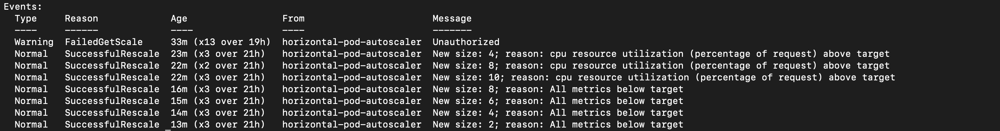
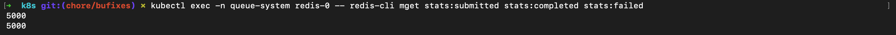

# k8s-monitoring

A queue-based job system on a local kind cluster. The API enqueues work in Redis through BullMQ. Workers run the jobs and scale with a Horizontal Pod Autoscaler. A stats service reads the counters. Prometheus scrapes metrics and Grafana shows them.

```
client -- :80 --> Ingress --> api (ClusterIP)
                              |
                              v
                           Redis / BullMQ
                              |
                              v
                           worker (HPA)
                              |
                              v
                           stats (ClusterIP, internal)
```

## Prerequisites

- Docker, or Colima with at least 5 GiB of VM memory
- kind
- kubectl
- Helm
- pnpm
- ApacheBench (`ab`)

## Local development

Install dependencies, copy the env file, and start Redis. The API and worker read `../.env` through their `dev` scripts.

```bash
pnpm install
cp .env.example .env
docker compose up redis
pnpm dev:api
pnpm dev:worker
```

## Docker Compose

`docker compose up` builds and starts Redis, the API, the worker, and stats. Host ports are Redis `6379`, API `3000`, worker metrics `9100`, and stats `3100`.

## Deploy

Create the cluster named `queue`. Port 80 and 443 are published for ingress-nginx. Port 30080 is published on `127.0.0.1` for Grafana.

```bash
kind create cluster --name queue --config kind-config.yaml
kubectl apply -f https://raw.githubusercontent.com/kubernetes/ingress-nginx/main/deploy/static/provider/kind/deploy.yaml
kubectl -n ingress-nginx rollout status deployment/ingress-nginx-controller --timeout=180s
./scripts/install-metrics-server.sh
```

Build the three images and load them into kind. The cluster will not pull `queue-*:latest` from a registry.

```bash
docker build -f Dockerfile --build-arg SERVICE=api -t queue-api:latest .
docker build -f Dockerfile --build-arg SERVICE=worker -t queue-worker:latest .
docker build -f Dockerfile --build-arg SERVICE=stats -t queue-stats:latest .
kind load docker-image queue-api:latest queue-worker:latest queue-stats:latest --name queue
```

Apply the app manifests in filename order, then install kube-prometheus-stack and the scrape config. The Helm release name `prometheus` matches the Service names used below.

```bash
kubectl apply -f k8s/00-namespace-config.yaml
kubectl apply -f k8s/10-redis.yaml
kubectl apply -f k8s/20-api.yaml
kubectl apply -f k8s/30-worker.yaml
kubectl apply -f k8s/40-ingress.yaml
kubectl apply -f k8s/50-hpa.yaml
kubectl apply -f k8s/60-stats.yaml
helm repo add prometheus-community https://prometheus-community.github.io/helm-charts
helm repo update
helm upgrade --install prometheus prometheus-community/kube-prometheus-stack \
  --namespace monitoring --create-namespace \
  -f monitoring/values.yaml
kubectl apply -f monitoring/servicemonitors.yaml
kubectl apply -f monitoring/worker-dashboard.yaml
kubectl apply -f monitoring/stats-dashboard.yaml
```

The JSON copies under `monitoring/dashboards/` are for manual Grafana import. They must stay in sync with those ConfigMaps.

## Accessing services

- API through the Ingress: `http://127.0.0.1/` (port 80). Use `127.0.0.1`, not `localhost`, so `ab` does not try IPv6.
- Grafana: `http://127.0.0.1:30080`. User `admin`, password `admin`. The kind port mapping binds this port to localhost only.
- Prometheus has no host port. Forward it:

```bash
kubectl -n monitoring port-forward svc/prometheus-kube-prometheus-prometheus 9090:9090
```

## API reference

`POST /submit` and `GET /submit` both enqueue one job and return `202` with `{ "id", "type" }`. The body is optional. When `type` is omitted the API picks one of `primes`, `bcrypt`, `sort`, or `memory`. `GET /submit` exists so a load test can call the URL without a body. It still enqueues a job.

`GET /status/:id` returns the job state and result while the job is still retained. Completed jobs are kept for 1 hour or 1000 jobs, whichever comes first. Failed jobs are kept for 1 day or 1000 jobs.

`GET /stats` is served by the stats Deployment inside the cluster on port 3100. It is not on the Ingress. It returns submitted, completed, failed, queue length, active jobs, and average processing seconds.

`GET /metrics` on the worker (port 9100) and on stats (port 3100) returns Prometheus text. The API and worker also serve `GET /health`.

## Stress test

Raise the open-file limit, then send the assignment command. Lower `-c` if the client starts failing requests.

```bash
ulimit -n 10240
ab -k -n 5000 -c 200 http://127.0.0.1/submit
```

POST with a JSON body also enqueues a job. An empty object lets the API choose the type:

```bash
curl -X POST http://127.0.0.1/submit -H 'content-type: application/json' -d '{}'
```

Use `127.0.0.1`, not `localhost`.

## Design notes

BullMQ stores the queue in Redis and lets the API process stay separate from the CPU work. Workers can scale without taking HTTP traffic.

The worker HPA keeps at least 2 pods and at most 10. It targets 70% of the container CPU request (100m). Scale-up has no stabilization window and may double the replica count every 30 seconds. Scale-down waits 120 seconds and removes at most 2 pods per minute.

Redis is one StatefulSet replica with AOF (`appendonly`, `appendfsync everysec`) and `noeviction`. Replication is not configured, so the replica count must stay 1. A headless Service backs the StatefulSet. The `redis` ClusterIP Service is what the apps use.

kind has no cloud load balancer. `extraPortMappings` in `kind-config.yaml` publish host ports into the node, and ingress-nginx binds host ports 80 and 443. The API Service stays ClusterIP and is only reached through the Ingress.

`GET /submit` has the same side effect as POST. That is only so `ab` can hit a URL with no body.

## Results and observations

Raw output is in [results/results-ab.txt](results/results-ab.txt), [results/results-hpa-describe.txt](results/results-hpa-describe.txt), and [results/results-hpa-watch.txt](results/results-hpa-watch.txt).

### Jobs completed during the load



Jobs completed starts rising just after 18:40. The job-errors panel has no series.

### HPA watch while replicas climb



The watch lists CPU above the 70% target and the replica column moving 2, 4, 8, then 10.

### Jobs completed after the load window



The completion rate peaks and then returns to zero in the window ending 18:47. Job errors stay empty.

### HPA rescale events



`SuccessfulRescale` events show 2 to 4, then 8, then 10 while CPU is above target, then 8, 6, 4, and 2 with "All metrics below target".

### Redis counters after the run



`MGET stats:submitted stats:completed stats:failed` printed 5000, 5000, and 0.

### `ab` results

From [results/results-ab.txt](results/results-ab.txt):

| Metric                | Value    |
| --------------------- | -------- |
| Complete requests     | 5000     |
| Requests per second   | 792.01   |
| Mean time per request | 252.5 ms |
| p50                   | 105 ms   |
| p95                   | 307 ms   |
| p99                   | 5282 ms  |
| Max                   | 6189 ms  |
| Time taken            | 6.313 s  |

`Failed requests: 4998` are all `Length` failures. `ab` counts a response as failed when its body length differs from the first response, and `/submit` returns a varying body (`{id, type}`). Connect, receive, and exception counts are 0. There were no non-2xx responses.

<!-- TODO(me): confirm the non-2xx claim from the access log if you want a second source besides the ab Length breakdown -->

### HPA summary

[results/results-hpa-describe.txt](results/results-hpa-describe.txt) events show the worker going 2 → 4 → 8 → 10, then 8 → 6 → 4 → 2 on scale-down.

A `FailedGetScale ... Unauthorized` line appears 13 times in those events.

<!-- TODO(me): explain FailedGetScale Unauthorized events -->

### Observations

- The jobs-completed panel returns to zero after the load window, which matches the backlog draining once submissions stop. The Redis counters above show submitted and completed both at 5000 and failed at 0.
- API latency has a long tail: p98 is 2598 ms (about 2.6 s) and p99 is 5282 ms (about 5.3 s) in the `ab` report. The API Deployment is set to a single replica.
- Linked files: [results/results-ab.txt](results/results-ab.txt), [results/results-hpa-describe.txt](results/results-hpa-describe.txt), [results/results-hpa-watch.txt](results/results-hpa-watch.txt).

<!-- TODO(me): confirm the running API replica count during this run, and whether the queue_length panel also showed the backlog drain -->

## Troubleshooting

- The HPA `TARGETS` column shows `<unknown>` until metrics-server is installed. Run `./scripts/install-metrics-server.sh`.
- A ServiceMonitor is not scraped when Prometheus only selects monitors in the Helm release namespace. `monitoring/values.yaml` sets `serviceMonitorSelectorNilUsesHelmValues: false`, and the monitors set `namespaceSelector` to `queue-system`.
- `ab` prints `Send request failed` when the URL uses `localhost` (IPv6). Use `127.0.0.1`.
- `helm install` fails when the Colima or Docker VM does not have enough memory. Give it at least 5 GiB.
- A rebuilt image is not what the pods run when the tag is still `:latest` and `imagePullPolicy` is `IfNotPresent`. Load the image into kind again and run `kubectl rollout restart`.

## Cleanup

```bash
kind delete cluster --name queue
```

## Known limitations

- The API Deployment is a single replica.
- Redis is a single replica with no replication.
- Grafana `admin` / `admin` is local-only. The kind port mapping binds `30080` to `127.0.0.1`.
- Images use the `:latest` tag with `imagePullPolicy: IfNotPresent`, so a redeploy needs `kubectl rollout restart` after `kind load`.
- `GET /submit` has a side effect: it enqueues a job.
